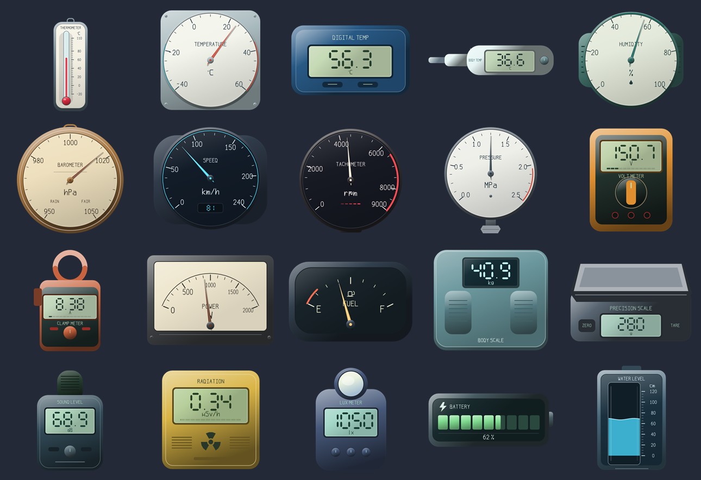

# メーター演出（SYNC_Meter）

温度計・速度計・電圧計など20種類の計測器を配置できる AviUtl2 用プラグインです。透明な背景に計測器を描き、タイムライン上で初期値から目標値まで動かせます。画像、フォント、音源の追加は不要です。

## インストール

Windows 64ビット版の AviUtl2 v2.1.16 以降に対応します。

1. AviUtl2 を終了し、配布ZIPを展開します。 [SYNC_Meter v1.0.0 の配布ZIP](https://github.com/vramwiz/SYNC_Meter/releases/download/v1.0.0/SYNC_Meter.zip)
2. 展開した `SYNC_Meter` フォルダーを `C:\ProgramData\aviutl2\Plugin\` にコピーします。
3. AviUtl2 を起動し、「メディアオブジェクトの追加」から「SYNC → メーター演出」を追加します。

## 使い方

1. 初期状態は液柱式温度計です。別の計測器を使うときは「プリセット」で種類を選び、「設定を反映」を押します。
2. 「計測設定」で表示範囲と、演出前の「初期値」、演出後の「目標値」を指定します。上昇と下降の両方に対応します。
3. 「時間設定」で開始までの待ち時間と、値の変化にかける時間を指定します。演出時間を0秒にすると、開始時点で目標値に切り替わります。
4. 位置、拡大率、透明度、回転、カメラによる配置は AviUtl2 の標準設定を使います。

プリセットを適用すると計測器の種類、表示範囲、初期値、目標値、単位、表示桁数、配色、異常値演出、効果音が切り替わります。時間設定は引き継がれ、適用後は各項目を個別に調整できます。

## 計測器と範囲外の表示

| 計測器 | 下限未満／上限超過の初期動作 |
| --- | --- |
| 液柱式温度計 | 下限停止／ひび割れ・破損・液体の飛散 |
| アナログ温度計、湿度計、気圧計、速度計、回転計、圧力計 | 下限停止／上限停止 |
| デジタル温度計、騒音計 | Lo／Hi |
| デジタル体温計 | L／H |
| 電圧計、電流計、電力計、放射線測定器 | 下限停止／上限停止・OL |
| 燃料計 | 空／満タン |
| 体重計、はかり | Err／Err |
| 照度計 | Lo／OL |
| バッテリー残量計、水位計 | 空／満充電・満水 |

初期値や目標値には、表示範囲の外の値も指定できます。液柱式温度計で破損を止めるには「異常値演出」で「上限・下限で停止」を選びます。

## 表示と効果音の調整

- 「計測設定」では小数点以下の表示桁数と単位を変更できます。単位の変更は表記だけに反映し、空欄にすると単位を省略します。
- 「色設定」では本体、表示面、計測表示、文字・目盛り、警告の色を調整できます。
- 電子式の計測器は、種類に応じて測定開始音、完了音、警告音を鳴らします。「効果音設定」で切り替え、0～100の音量を指定できます。初期音量は50です。

## ライセンス

GNU General Public License v3.0（GPL-3.0-only）で配布します。 [ライセンス全文](LICENSE) · [第三者ライセンス](THIRD_PARTY_NOTICES.md)
